# Transformer / GPT 可视化笔记

> 整理自 3Blue1Brown《But what is a GPT? Visual intro to Transformers》的手记，并做了修正与扩充。
> 文中参数以 **GPT-3** 为例：嵌入维度 12,288，词表 50,257，96 层，每层 96 个注意力头。
>
> 配图来自 3Blue1Brown 官方课程文字版（[Ch.5 Transformers](https://www.3blue1brown.com/lessons/gpt/)、[Ch.6 Attention](https://www.3blue1brown.com/lessons/attention/)、[Ch.7 MLP](https://www.3blue1brown.com/lessons/mlp/)），版权归 3Blue1Brown 所有，仅供个人学习参考。

## 目录

- [1. 嵌入与反嵌入](#1-嵌入与反嵌入)
- [2. 注意力机制（Attention）](#2-注意力机制attention)
- [3. 多头注意力（Multi-Head Attention）](#3-多头注意力multi-head-attention)
- [4. MLP（前馈网络）](#4-mlp前馈网络)
- [5. 叠加（Superposition）](#5-叠加superposition)
- [6. 参数量速查表](#6-参数量速查表)

---

## 1. 嵌入与反嵌入

### 嵌入矩阵 W_E（Embedding matrix）

- 作用：**词（token）→ 向量**。查表操作，每个 token 对应一行嵌入向量。
- 严格说，并不是"一个词对应一个 token"，切分结果取决于 tokenizer（如 BPE 会把词拆成子词），这里为了便于理解先按"词 = token"处理。

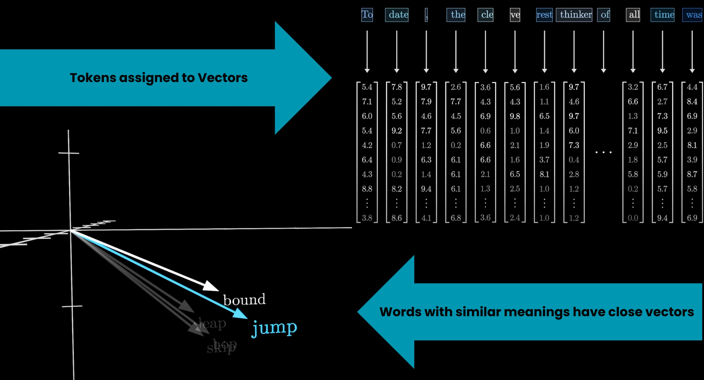

- GPT-3 规模：`12,288 维 × 50,257 tokens ≈ 6.18 亿` 个参数。

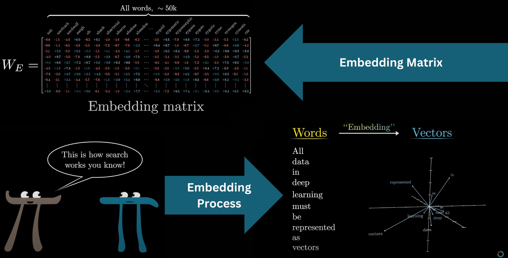
- 关键性质：**嵌入是"孤立"编码的**——初始向量只由这个词本身决定，不包含任何上下文信息。上下文信息要靠后面的注意力层注入。

### 反嵌入矩阵 W_U（Unembedding matrix）

- 作用：**向量 → 词表上的概率分布**，即模型的输出层。
- 词表中每个词对应 W_U 的一行；用处理后的最终向量与每一行做点积，得到该词的分数。
- 形状同样是 `12,288 × 50,257 ≈ 6.18 亿` 参数。

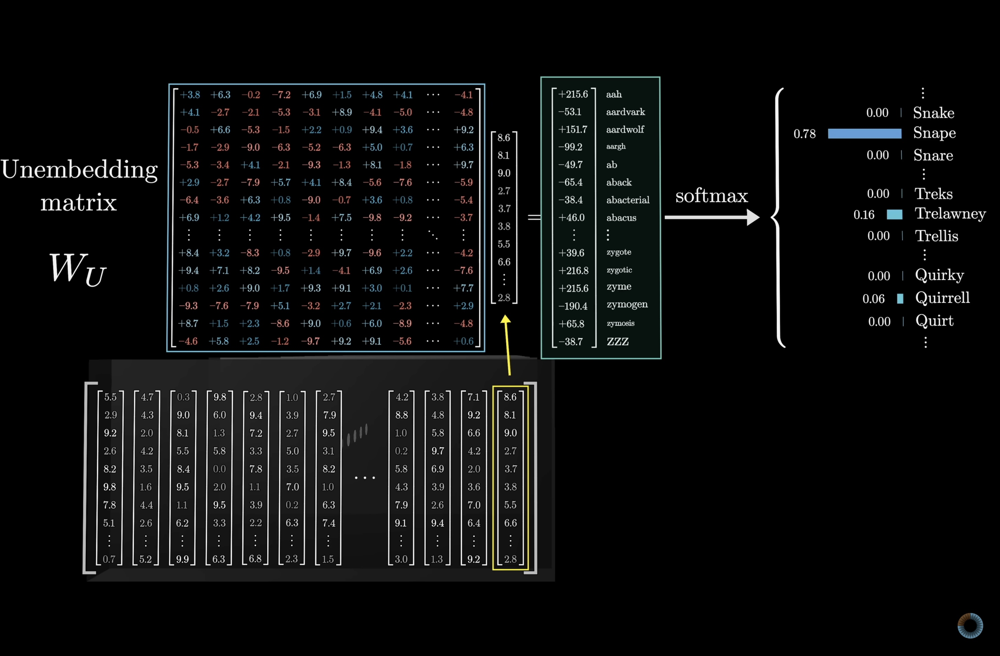

- 实践中 W_U 常与 W_E **权重共享（weight tying）**，即两个矩阵是同一个。

### 从分数到概率：logits 与 softmax

- **logits**：反嵌入矩阵输出的原始分数（未归一化，可为任意实数）。
  - 注：手记里写反了——logits 是 softmax 的**输入**，不是输出。
- **softmax**：把 logits 归一化到 (0, 1) 且总和为 1 的概率分布：

$$\text{softmax}(z_i) = \frac{e^{z_i}}{\sum_j e^{z_j}}$$

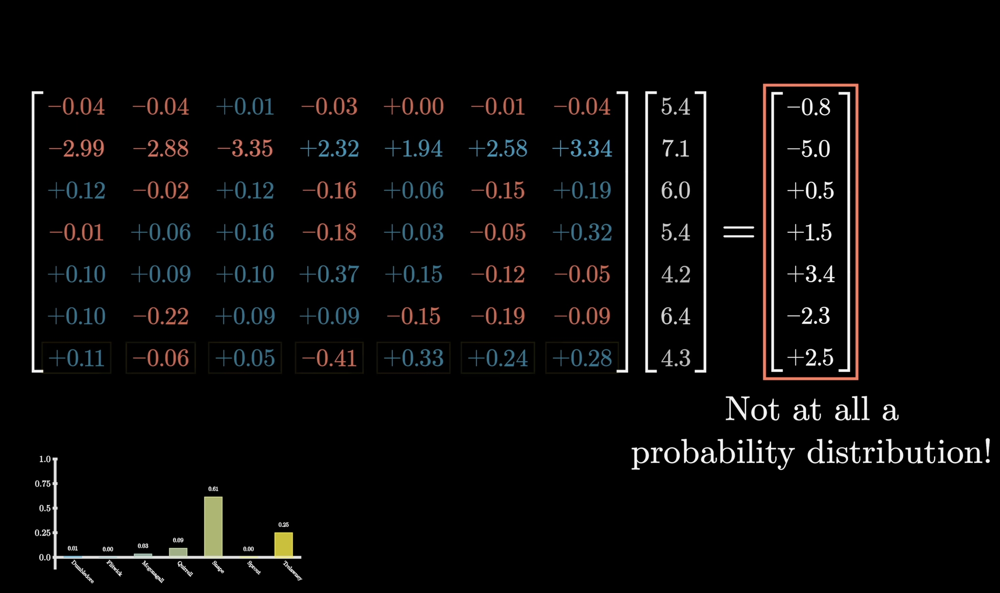

### 输入向量 E

Transformer 中每个 token 的初始输入向量 = **词嵌入 + 位置编码**：

$$E = \text{Embedding}(\text{token}) + \text{PositionEncoding}(\text{pos})$$

即"这个词是什么" + "它在第几个位置"。（GPT 系列使用可学习的位置嵌入向量。）

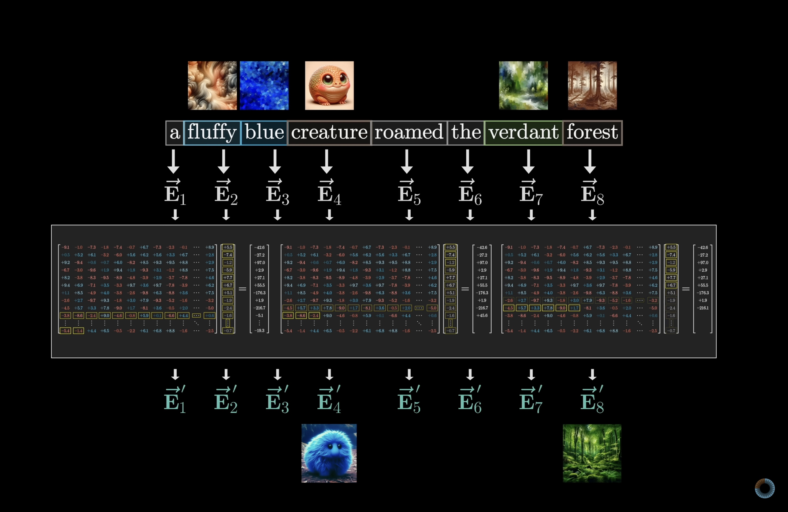

---

## 2. 注意力机制（Attention）

贯穿全文的例子：**"A fluffy blue creature roamed the verdant forest"**

直觉目标：读到 `creature` 时，模型应该"回头看"前面的 `fluffy`、`blue`，把形容词的含义吸收进 `creature` 的向量里，变成 "fluffy blue creature"。

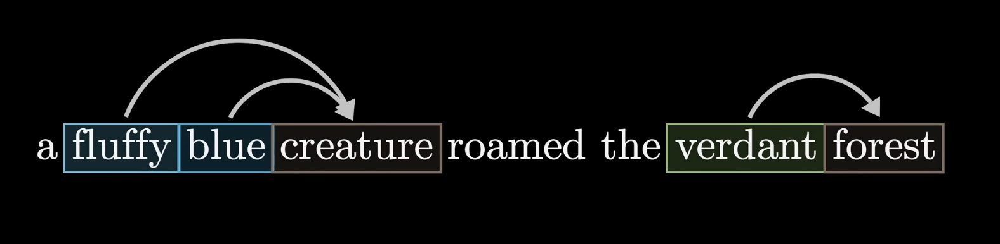

### 2.1 Query：我在找什么？

- 对每个 token 的输入向量 E，用矩阵 W_Q 生成一个**查询向量**（128 维）：

$$Q = W_Q \cdot E$$

- 直觉：`creature` 的 Query 相当于在问 **"我前面有形容词吗？"**
- 每个 token 都会生成自己的 Query。

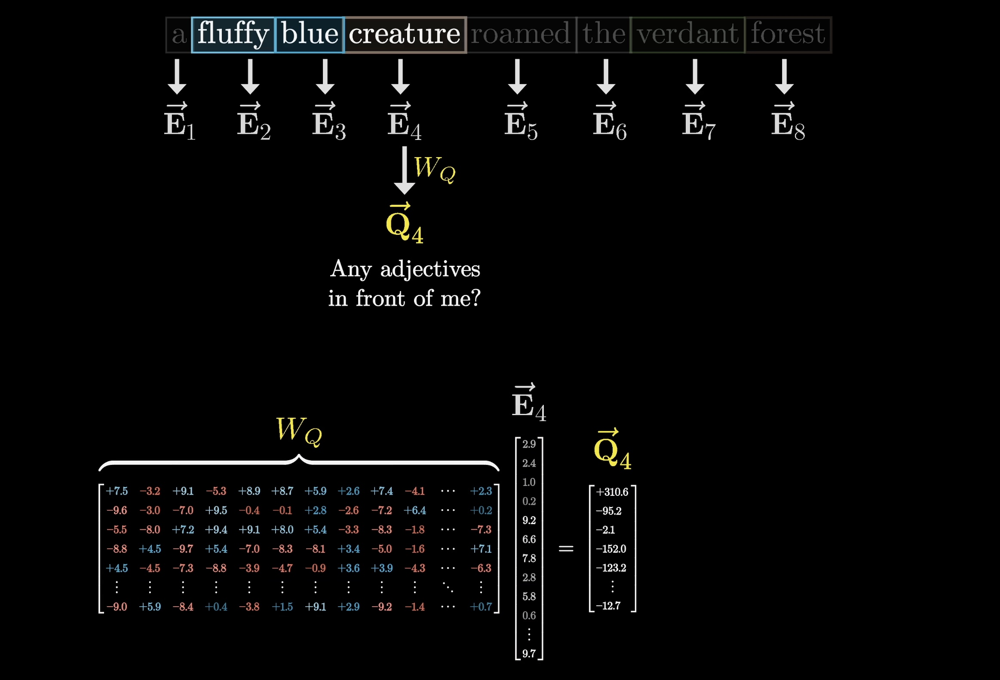

### 2.2 Key：我能回答什么？

- 同样用矩阵 W_K 生成**键向量**：

$$K = W_K \cdot E$$

- 直觉：Key 是 Query 的"潜在答案"。`fluffy` 的 Key 表示"我是一个形容词，可以修饰后面的名词"。

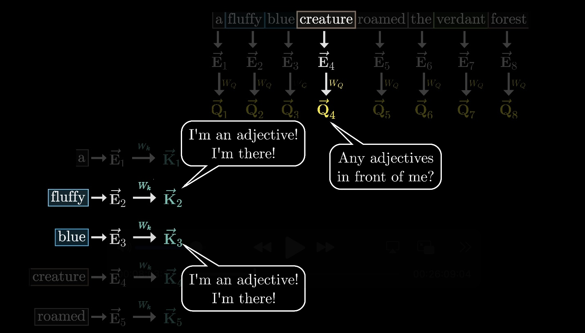
- 如果 Q 和 K 在 128 维的 Query/Key 空间中**方向接近（对齐）**，说明这两个 token 相关。
  - 手记中的 `Wk * E = Q` 是笔误，应为 `Wk * E = K`。

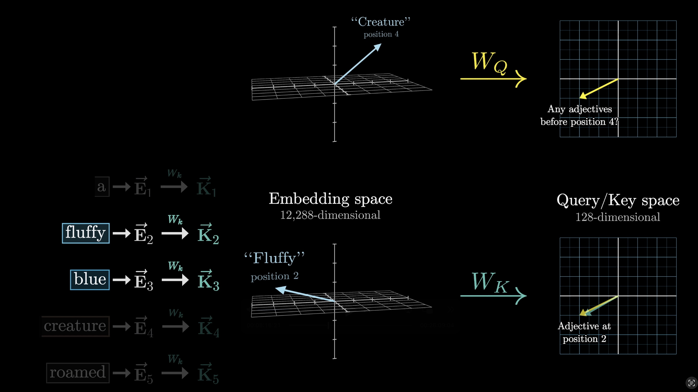

### 2.3 注意力分数网格

- 用**点积**衡量每一对 (Query, Key) 的对齐程度：点积越大，相关性越强。
- 所有 token 两两组合构成一个网格（矩阵），大小为 **(上下文长度)²**。
  - 例如 `fluffy`、`blue` 的 Key 与 `creature` 的 Query 点积很大 → 它们会强烈"关注"到 creature。

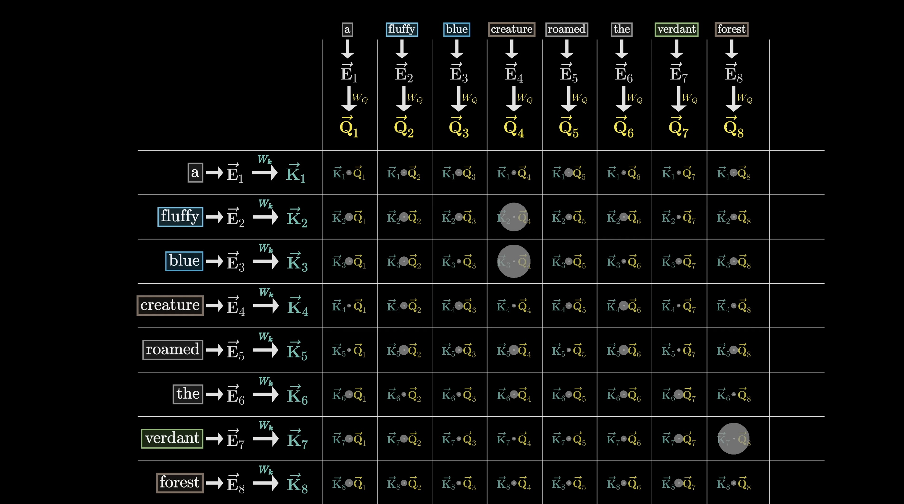

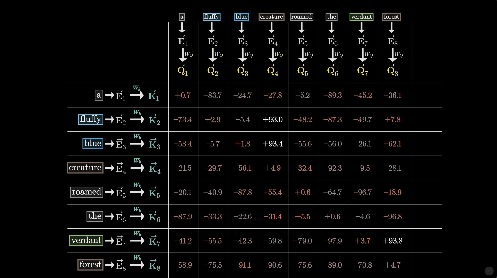
- 对网格的**每一列做 softmax**，得到归一化的**相关性权重**（每列和为 1）。

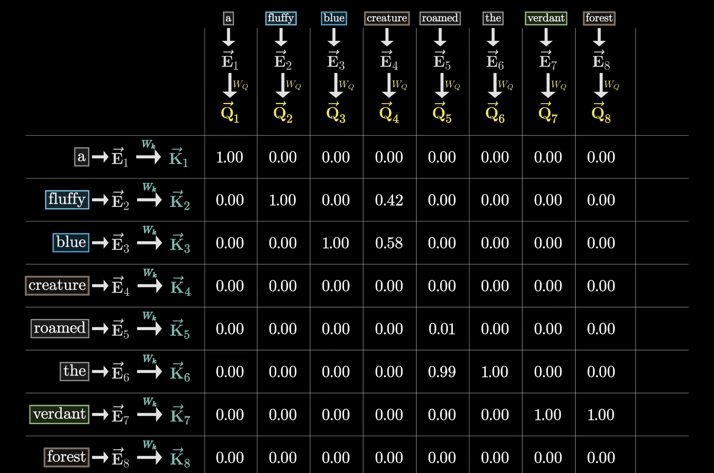
- 通常还会除以 $\sqrt{d_k}$（缩放点积注意力），防止点积过大导致 softmax 梯度消失：

$$\text{Attention}(Q,K,V) = \text{softmax}\left(\frac{QK^T}{\sqrt{d_k}}\right)V$$

### 2.4 因果掩码（Masking）

- GPT 是自回归语言模型：预测下一个词时，**不能看到后面的 token**（否则就是"作弊"）。
- 做法：在 softmax **之前**，把网格中"第 i 个 token 关注第 j > i 个 token"的位置标记为 **负无穷（-∞）**，softmax 之后这些位置的权重就变成 0。
- 等价于只保留注意力网格的**下三角**部分。

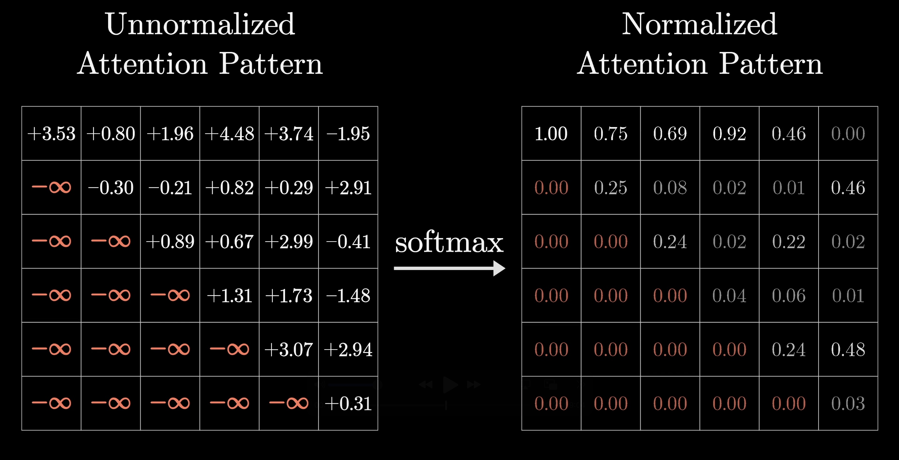

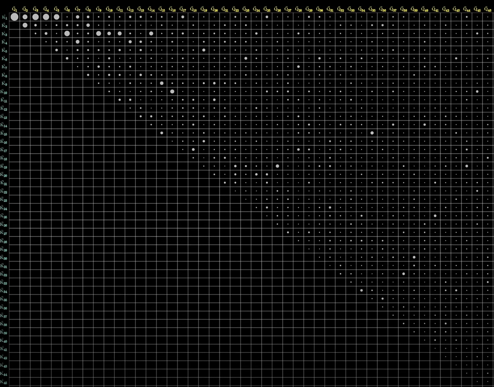
  - 注：手记里 "preventing later tokens influenced by earlier tokens" 方向写反了，应为**防止前面的 token 受后面 token 影响**。

### 2.5 Value：实际要加进去的内容

- 用矩阵 W_V 生成**值向量**：

$$V = W_V \cdot E$$

- 直觉：如果某个词与"调整另一个词的含义"相关，那么**应该往那个词的向量里加什么**？
  - 例如把 `fluffy` 的含义加到 `creature` 上，得到 "fluffy creature"。

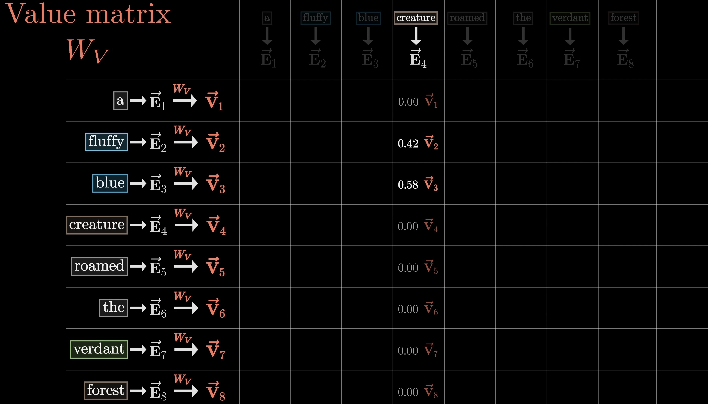
- 计算方式：对网格的每一列，用该列的相关性权重对所有 token 的 Value 向量做**加权求和**，得到该位置的增量 ΔE：

$$\Delta E_i = \sum_j w_{ij} \cdot V_j$$

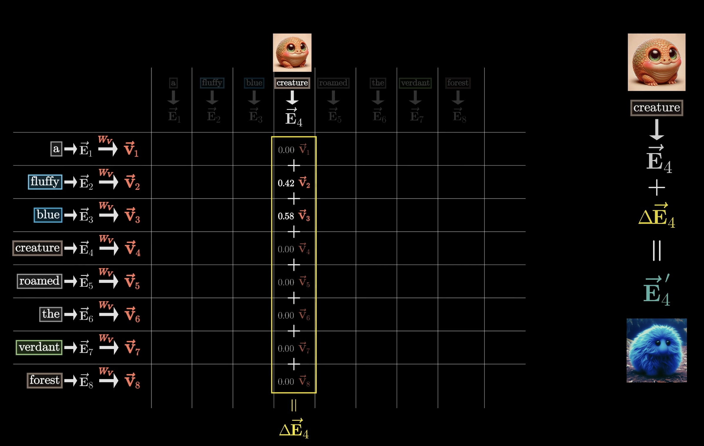

- 更新嵌入：

$$E' = E + \Delta E$$

  此后 `creature` 位置的向量就融合了 "fluffy blue creature" 的信息。

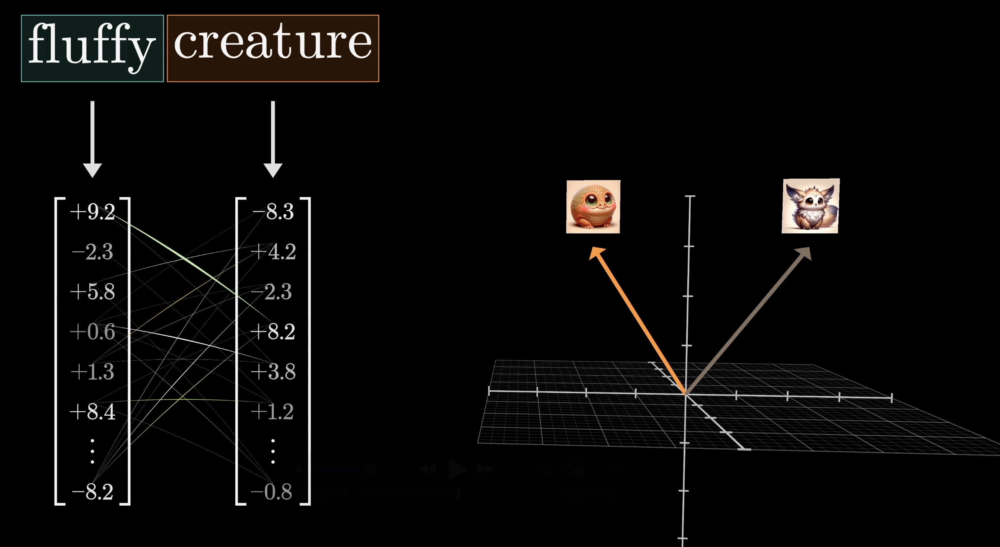

### 2.6 一个注意力头的参数量

以上整个流程（Q、K、V 的生成 + 加权求和）称为**一个注意力头（head）**，由 W_Q、W_K、W_V 参数化。

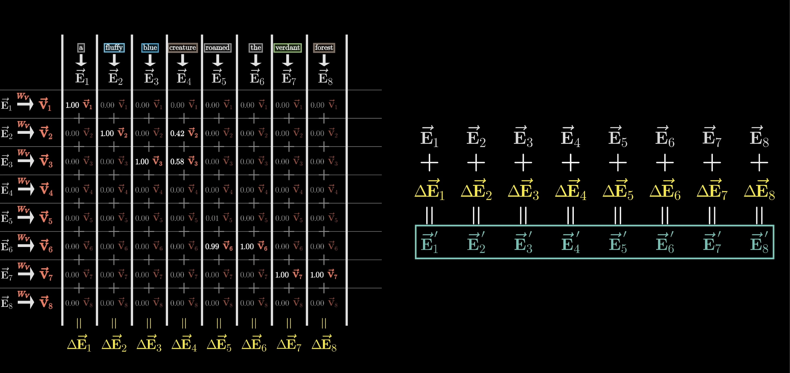

| 矩阵 | 形状 | 参数量（每头） |
|---|---|---|
| W_Q | 12,288 → 128 | 12,288 × 128 = 1,572,864 |
| W_K | 12,288 → 128 | 12,288 × 128 = 1,572,864 |
| W_V（不用低秩时） | 12,288 → 12,288 | 150,994,944 |

### 2.7 低秩分解（Low-Rank）的 W_V

如果 W_V 直接是 `12,288 × 12,288`，每个头就要 1.5 亿参数，96 个头 × 96 层完全不可接受。解决办法是把它拆成**两个小矩阵**（即线性代数中的**低秩变换**）：

- **Value down 矩阵**（先降维）：`128 × 12,288`，把 12,288 维映射到 128 维；
- **Value up 矩阵**（再升维）：`12,288 × 128`，把 128 维映射回 12,288 维。

这样每头 W_V 的参数量变为 `12,288 × 128 × 2 = 3,145,728`，缩小约 **48 倍**。

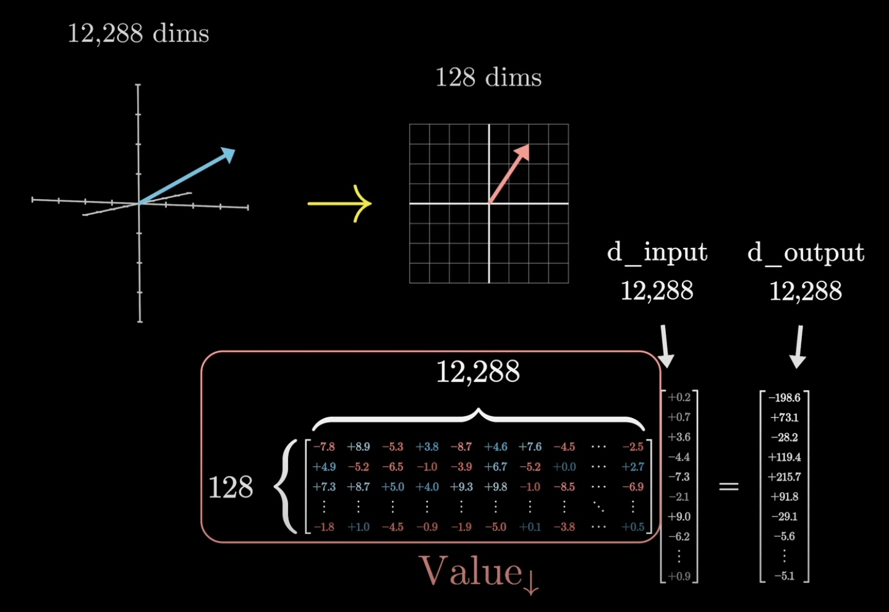

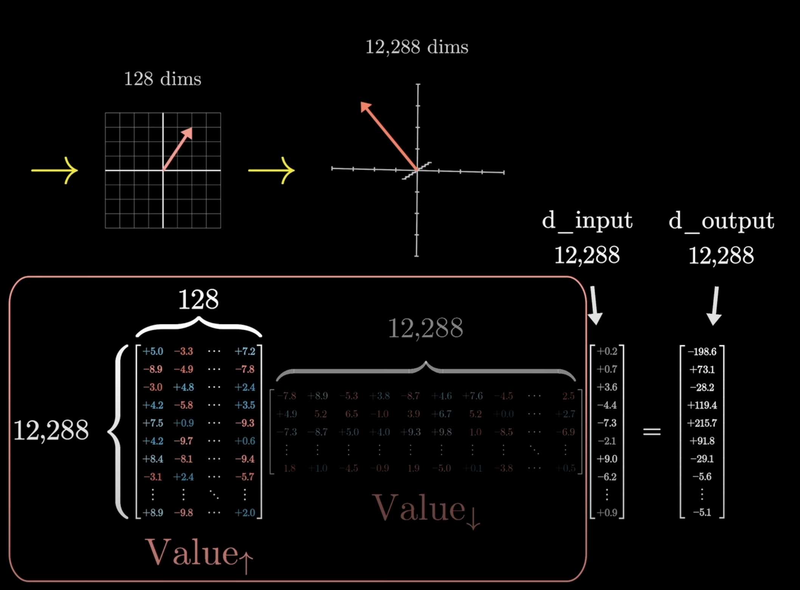

> 直觉：值的"内容"其实只需要 128 维就足够表达，先压缩再展开不会损失太多信息，却大幅节省参数。

---

## 3. 多头注意力（Multi-Head Attention）

- 做法：**并行运行多个单头注意力**，每个头有各自独立的 W_Q、W_K、W_V。
- GPT-3 每层使用 **96 个头**，每个头的 Query/Key 空间是 128 维（96 × 128 = 12,288，正好等于嵌入维度）。

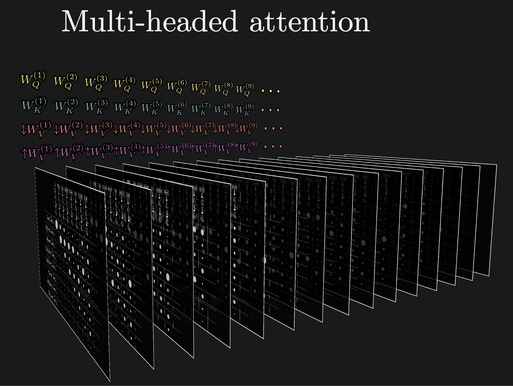
- 96 组 W_Q & W_K 产生 **96 种不同的注意力模式**，例如：
  - 一个头关注"前面的形容词"；
  - 一个头关注"最近的名词"；
  - 一个头关注"指代关系"等等。
- 每个头对每个 token 都提出一个"修改建议"（ΔE），全部**相加**到原嵌入上：

$$E_i \leftarrow E_i + \Delta E_{i,1} + \Delta E_{i,2} + \cdots + \Delta E_{i,96}$$

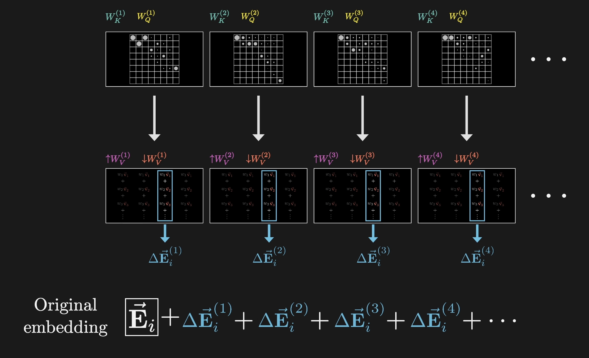

> 可以把多头理解为"96 个专家各自给出一条修改意见，然后汇总"。

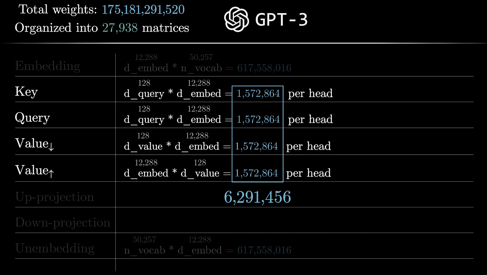

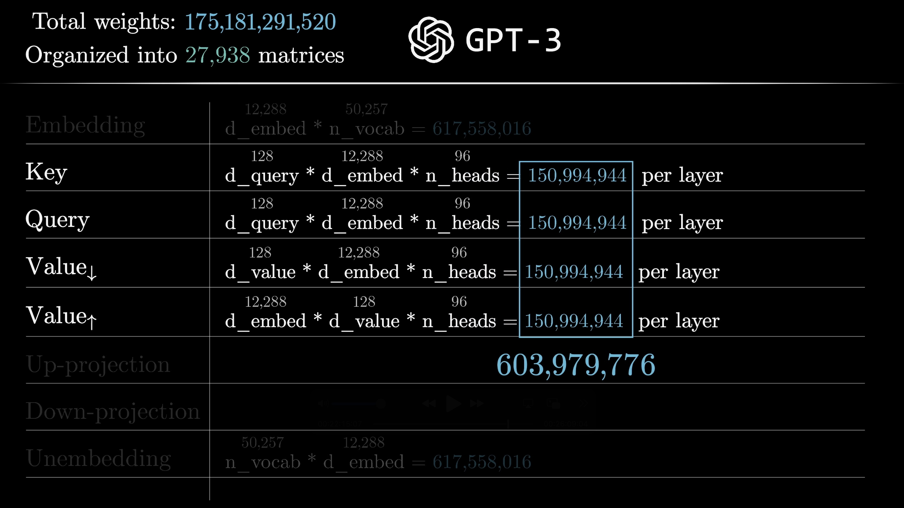

---

## 4. MLP（前馈网络）

一个 Transformer 层的结构是：**注意力子层 → MLP 子层**（都带残差连接）。

- 参数量分布：注意力约占 **1/3**，MLP 约占 **2/3** —— MLP 才是参数大头。
- 直觉例子：

  `"Michael Jordan"`（经过注意力后已聚合姓名信息）→ MLP → 联想到 `"Basketball"`

  即 MLP 像一块**知识存储器 / 联想记忆**，把上下文中识别出的概念映射到相关概念。

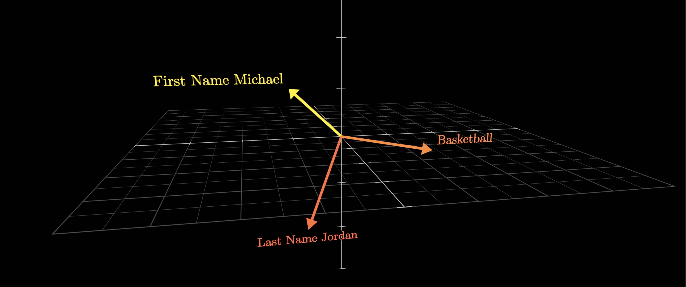

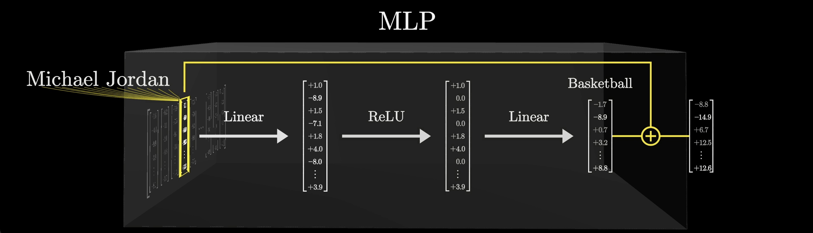

### 4.1 第一个线性层（升维，W_up）

$$n = \text{ReLU}(W_{up} \cdot E + b_{up})$$

- W_up 形状：`49,152 × 12,288`（GPT-3 把维度放大 4 倍：4 × 12,288 = 49,152）。
- **每一行是一个"问题"**：某一行与输入向量做点积，输出该问题的"匹配分数"。
  - GPT-3 每层 MLP 相当于问 49,152 个问题，例如"这是人名吗？""这是体育相关吗？"
- **偏置向量 b_up**：调整每个点积的输出（决定问题的"触发阈值"）。

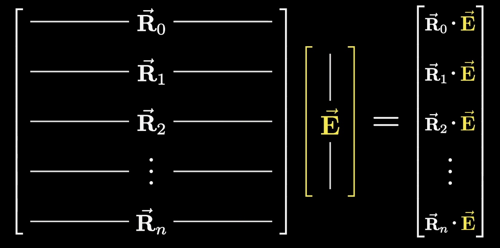

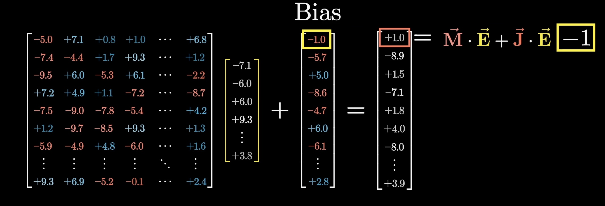

### 4.2 ReLU 激活

- Rectified Linear Unit：$\text{ReLU}(x) = \max(0, x)$
- 直觉是一个"是/否"开关：**负值全部置 0**，只有匹配度足够高的"问题"（神经元）才会被激活。

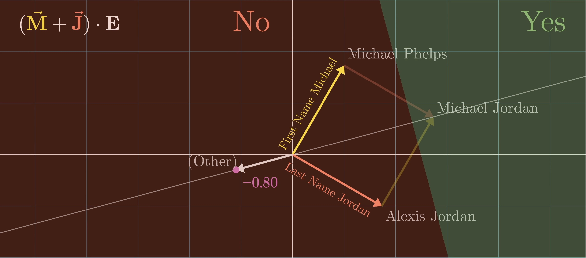
- 引入非线性——没有它，两个线性层叠加还是一个线性变换。

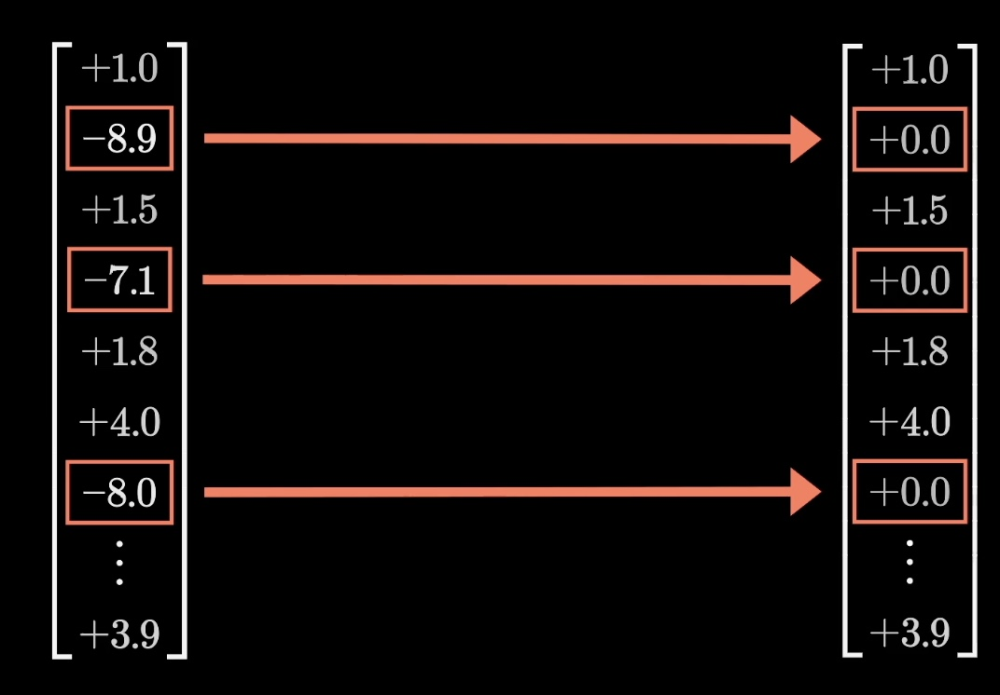

### 4.3 第二个线性层（降维，W_down）

$$\Delta E = W_{down} \cdot n + b_{down}$$

- W_down 形状：`12,288 × 49,152`，把维度映射回输入大小。

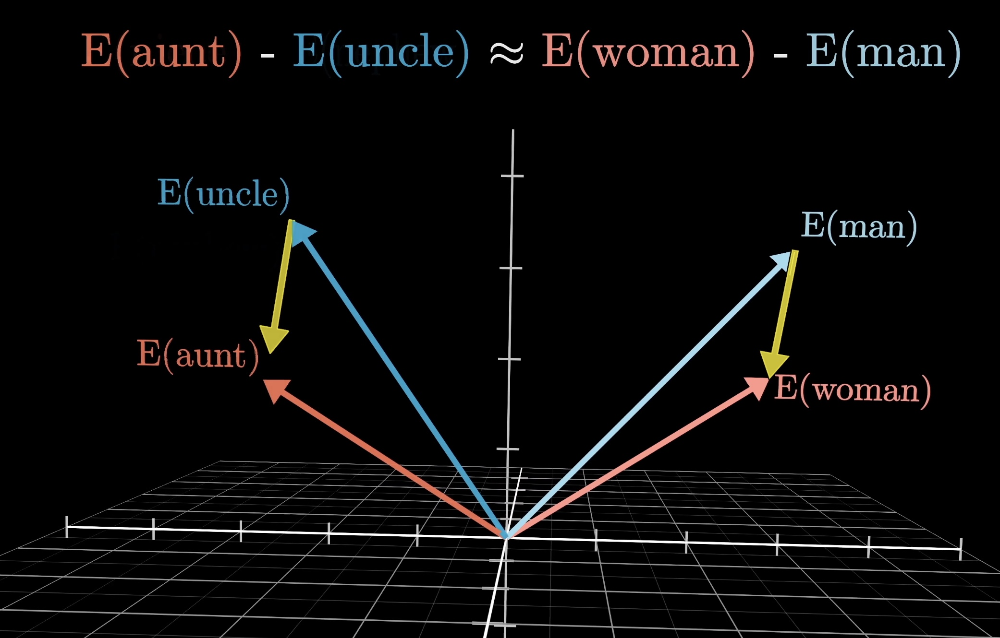
- **每一列是一个"方向"**：如果第 j 个神经元被激活（n_j > 0），就把第 j 列对应的向量加进结果；否则没有贡献。
  - 例如"篮球"这个概念对应某一列方向；只有当"是体育人物"之类的神经元激活时，"Basketball" 的含义才会被写入输出。

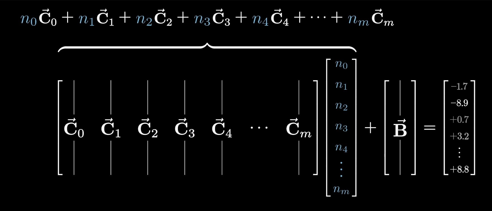

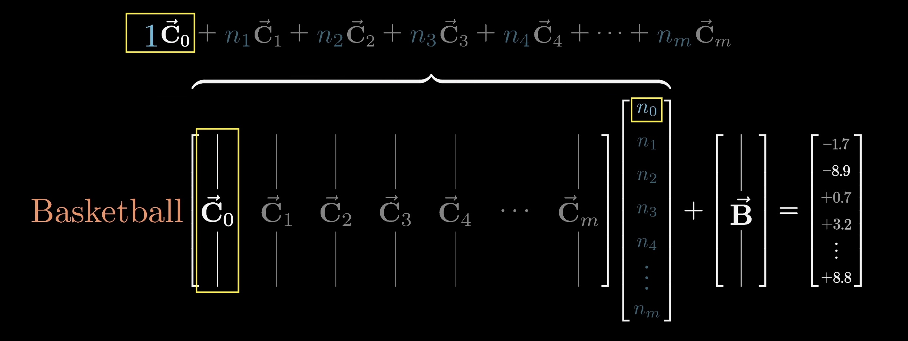
- 直觉：每个激活的神经元 = "往最终结果里添加某个特定含义"。

### 4.4 残差连接（Residual）

MLP 的输出**加回**输入向量（而不是替换它）：

```
输入:  F.N."Michael" + L.N."Jordan"
输出:  F.N."Michael" + L.N."Jordan" + "Basketball"
```

这与注意力子层的 `E' = E + ΔE` 一致——整个 Transformer 可以看作一条"残差流"（residual stream），每一层都只是往流里**读写增量信息**。

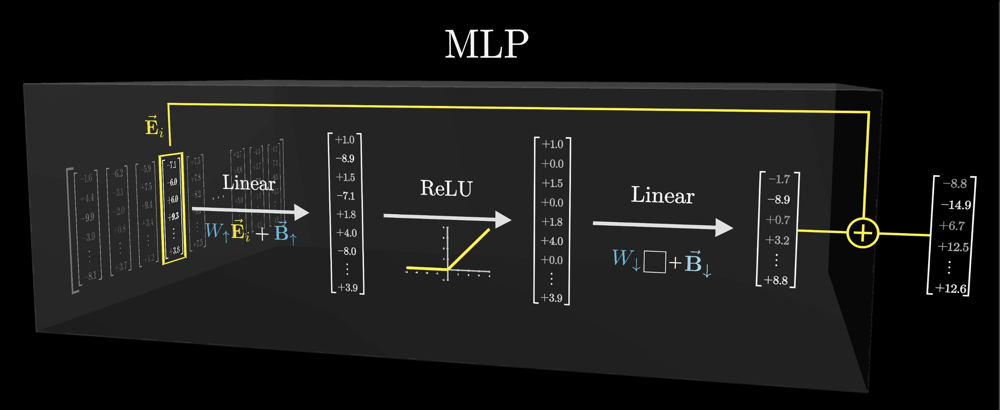

### 4.5 并行性

- 所有位置的向量**同时并行处理**（这正是 Transformer 相对 RNN 的核心优势，可充分利用 GPU）。
- GPT-3 共 **96 层**，每层 = 多头注意力 + MLP，结构重复堆叠。

---

## 5. 叠加（Superposition）

可解释性研究中的一个核心现象：

- 模型存储的"概念/特征"数量**远超向量空间的维度**（例如 12,288 维空间里可能编码几十万个特征）。
- 实现方式：利用空间中**近似垂直（near-orthogonal）的方向**来表示不同特征——近似垂直的方向之间干扰很小。

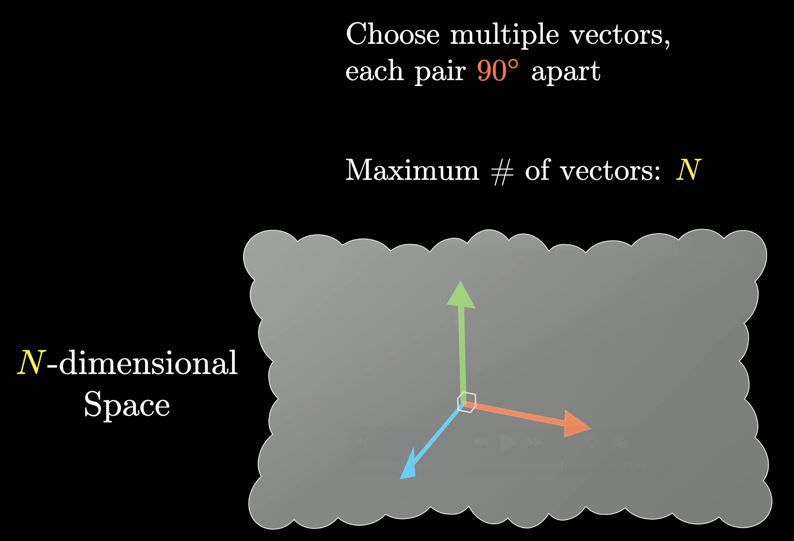
- 理论依据：**Johnson–Lindenstrauss 引理**的一个推论——在 n 维空间中，能塞进去的"两两近似垂直"的向量数量随维度 n **指数级增长**。

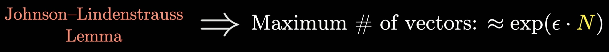
- 推论：**一个特征不是由单个神经元表示，而是由神经元的一种特定组合（一个方向）表示**。这就是为什么直接看单个神经元的激活很难解释模型行为（特征叠加在多个神经元上，一个神经元也可能参与多个特征）。

> 扩充：这也是 **Mechanistic Interpretability（机制可解释性）** 领域的出发点——Anthropic 等团队用稀疏自编码器（SAE）等技术，试图把叠加的特征从超维空间中"解叠加"出来。

---

## 6. 参数量速查表

以 GPT-3（d = 12,288，96 层，96 头/层，头维度 128，词表 50,257）为例：

| 组件 | 形状 | 参数量 | 备注 |
|---|---|---|---|
| 嵌入 W_E | 50,257 × 12,288 | ≈ 6.18 亿 | 查表，无上下文 |
| 反嵌入 W_U | 12,288 × 50,257 | ≈ 6.18 亿 | 常与 W_E 共享 |
| W_Q（每头） | 128 × 12,288 | ≈ 157 万 | 生成查询 |
| W_K（每头） | 128 × 12,288 | ≈ 157 万 | 生成键 |
| W_V（每头，低秩） | 128×12,288 ×2 | ≈ 315 万 | down + up |
| 注意力（每层合计） | — | ≈ 6,000 万 | 96 头之和 |
| MLP W_up（每层） | 49,152 × 12,288 | ≈ 6.04 亿 | 每行一个"问题" |
| MLP W_down（每层） | 12,288 × 49,152 | ≈ 6.04 亿 | 每列一个"方向" |
| **总计** | — | **≈ 1,750 亿** | 即 GPT-3 的 175B |

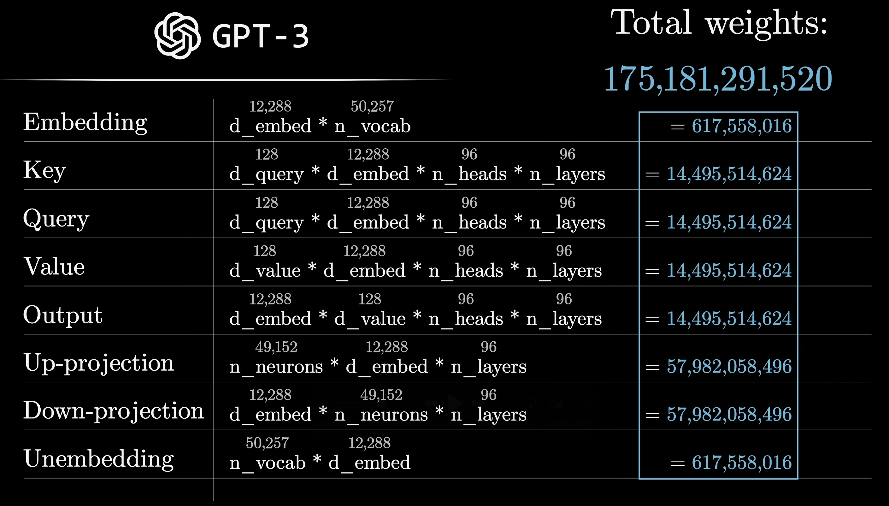

### 一层 Transformer 的完整数据流

```
E ──► (+位置编码)
      │
      ▼
┌─────────────────────┐
│ 多头注意力 (96 heads) │  E' = E + Σ ΔE_head   ← 残差
│  Q=WE·E  K=WK·E     │     (带因果掩码)
│  V=Wdown·Wup·E      │
└─────────────────────┘
      │
      ▼
┌─────────────────────┐
│ MLP                 │  n = ReLU(Wup·E' + bup)
│  升维→ReLU→降维      │  E'' = E' + Wdown·n + bdown  ← 残差
└─────────────────────┘
      │
      ▼  (重复 96 层)
      │
      ▼
W_U · E_final ──► logits ──► softmax ──► 下一个 token 的概率分布
```
